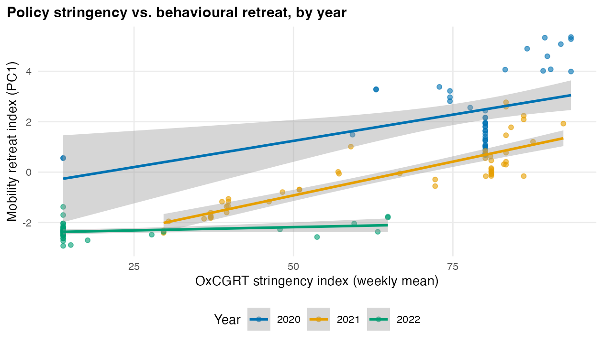
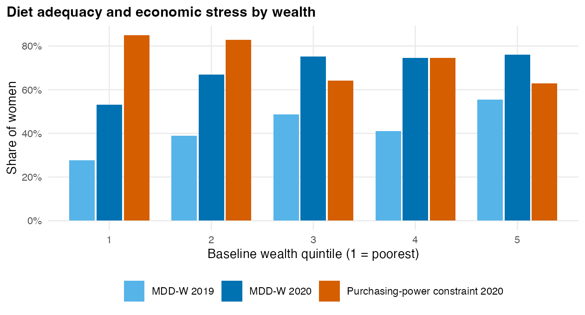
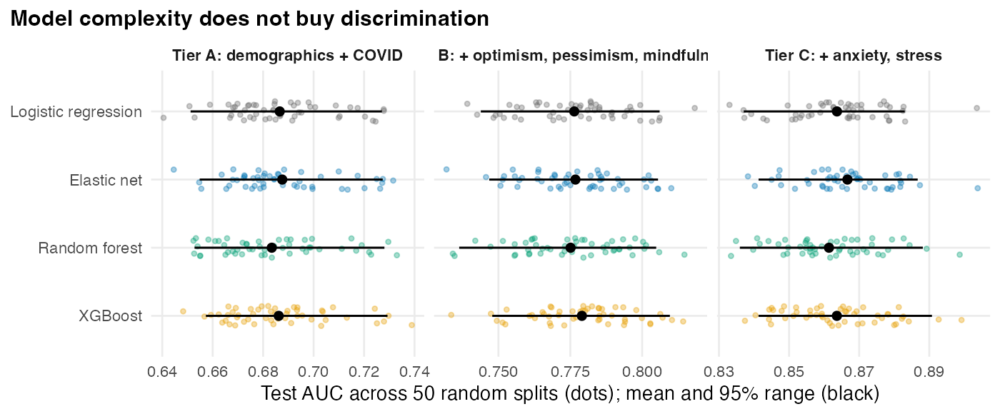

# Beyond the Case Count

**Mobility, diet and mental health in Bangladesh during COVID-19: a reproducible re-analysis of three open datasets**

Mohammad Nobinur · Independent research project, 2024 · R, Python, LaTeX

[Read the full report (PDF)](Final_Report.pdf)

---

## Summary

Case counts record confirmed infections. They say little about how the pandemic changed life for everyone else in Bangladesh. This project re-analyses three open datasets, each at a different scale:

- **National:** daily epidemic, policy and Google mobility series, 2020–2022.
- **Household:** a two-round panel of 832 rural women interviewed in November 2019 and again in November 2020.
- **Individual:** an online mental-health survey of 1,897 adults, collected in May–June 2021.

I first reproduced the published estimates, then checked which conclusions hold up under stricter analysis: differenced time-series models, change scores, prevalence ratios, repeated-split model comparison and a data-quality audit.

## Findings

**1. Mobility followed policy less closely over time.** In 2020, a change in policy stringency moved mobility about six times as much as the same change did in 2022 (weekly first differences: slope 0.037 vs 0.006, interaction *p* < 0.001). Ordinary activity drifts away from Google's fixed early-2020 baseline, so the 2022 mobility levels partly reflect that drift.

<p align="center"></p>

**2. Women's diets did not collapse.** Diet diversity rose by 1.10 food groups between 2019 and 2020, and the share of women meeting the minimum dietary diversity standard rose from 40.5% to 66.8%, even though 75% reported purchasing-power constraints. I found no evidence that the gain differed across wealth quintiles (*p* = 0.70). The gap between the poorest and richest women was already there before the pandemic (28% vs 55% meeting the standard) and remained afterwards (53% vs 76%). The follow-up was by phone and the baseline in person, so the rise cannot be separated from a survey-mode effect.

<p align="center"></p>

**3. Complex models did not predict better.** I predicted probable depression (PHQ-9 ≥ 10) with logistic regression, elastic net, random forest and XGBoost, each re-tuned and re-tested on 50 random splits. The other three came within 0.003 mean AUC of logistic regression, far less than the variation between splits (SD 0.013–0.022). Demographic and COVID-exposure variables alone reached an AUC of 0.69, and adding the optimism, pessimism and mindfulness scales raised it to 0.78. The five mindfulness items alone reached 0.73. For comparison, two PHQ-9 items, which are part of the outcome, reach 0.87 on their own.

<p align="center"></p>

**4. The data needed auditing.** The published prevalences reproduce exactly: 45.3% probable depression and 62.5% probable anxiety. Fitted to the full sample, several Gaussian mixture models isolated a small class with almost no variance. Its members were mostly templated records. A direct screen flags 67 respondents who share identical answer blocks on the 19 non-outcome items, 66 of them from one division, and none screens positive for depression. Excluding them moves that division's adjusted odds ratio for depression from 0.47 to 0.58 and the two-dose vaccination odds ratio from 0.57 to 0.62. The other main associations change little.

## Methods

| Scale | Data | Methods |
|---|---|---|
| National | OWID, OxCGRT, Google mobility | PELT change points with penalty sensitivity, PCA mobility index, first-differenced regression with Newey–West SEs |
| Household | Women's diet panel, Faridpur and Patuakhali | Paired t / Wilcoxon, McNemar with BH correction, change-score models and ANCOVA (HC3) |
| Individual | Online survey (PHQ-9, BAI, PSS-4, LOT-R, MAAS) | Cronbach's α / McDonald's ω, Wilson CIs, logistic and modified-Poisson regression with BH q-values, latent profile analysis (mclust, ICL) |
| Prediction | Same survey | 4 learners × 3 nested feature sets, stratified hold-out plus 50 repeated splits, DeLong tests, calibration, feature ablation, permutation importance, scikit-learn re-implementation |

## Reproduce

```bash
python3 -m venv .venv && .venv/bin/pip install -r python/requirements.txt
./reproduce.sh     # downloads data if missing, runs all analyses, builds Final_Report.pdf (about 5 min)
```

Requirements: R with tidyverse, haven, kableExtra, patchwork, changepoint, sandwich, lmtest, psych, ggcorrplot, mclust, cluster, nnet, glmnet, ranger, xgboost, pROC, zoo and here; a TeX distribution with biblatex-apa and biber.

Every number, table and figure in the report is generated by the scripts. R writes LaTeX macros and tables that the report reads with `\input`, so the text cannot drift from the results.

## Data

The survey, the diet panel, Our World in Data and OxCGRT are released under CC BY 4.0. Google's Community Mobility Reports are published under Google's own terms, not an open licence. `scripts/download_data.sh` re-creates `data/raw/` from the original sources.

- Mental-health survey: Islam (2022), Mendeley Data, [doi:10.17632/6szgbkpzn8.1](https://doi.org/10.17632/6szgbkpzn8.1), CC BY 4.0
- Women's diet panel: Lecoutere, van den Berg & de Brauw (2021), Mendeley Data, [doi:10.17632/hxf7nb964d.2](https://doi.org/10.17632/hxf7nb964d.2), CC BY 4.0
- [Our World in Data COVID-19](https://github.com/owid/covid-19-data) (CC BY 4.0), [OxCGRT](https://github.com/OxCGRT/covid-policy-dataset) (CC BY 4.0), [Google Community Mobility Reports](https://www.google.com/covid19/mobility/) (Google's terms)

## Limitations

- The survey is an online convenience sample (young, urban, educated) with a single time point, so its prevalences describe the respondents only, and none of the associations is causal.
- The household panel covers two districts and changed survey mode between rounds.
- The three datasets cannot be linked person to person.

## License

Code: [MIT](LICENSE). Data remain under their original licences listed above. To cite this work, see [CITATION.cff](CITATION.cff).
